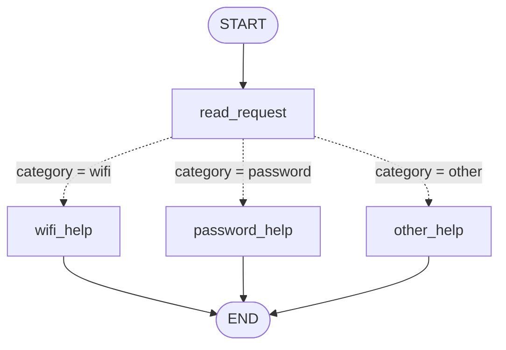
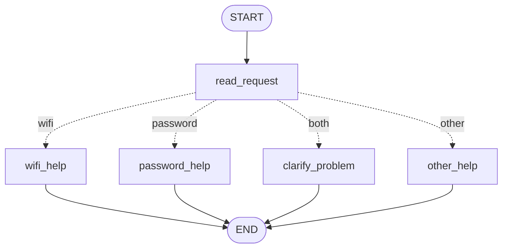
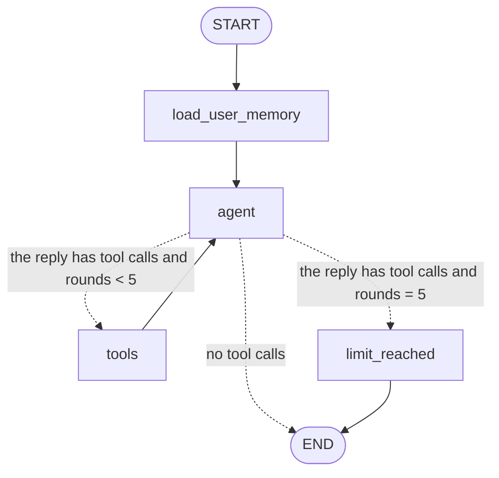

# HW5 — My LangGraph helpdesk

**Name:** Askar Zhurabekov · **Student ID:** 67529 · **Group:** 9
**Repository:** https://github.com/Asik456/homeworkAI5

**AI assistance:** I used Claude Code (Anthropic) to help me plan the graphs, write the code and tests, run the scenarios and write this file from my own runs.

## Part 1 — How the graph works

### My graph and state

The first graph has **no model**. My own Python rules choose the path.



The state is one small dictionary:

| Field | What it holds | Who writes it |
| --- | --- | --- |
| `message` | the user's original message | the user (input) |
| `category` | `wifi`, `password` or `other` | `read_request` |
| `reply` | the answer for the user | one help node |

Example: input `{"message": "I cannot connect to Wi-Fi."}` → after `read_request`: `category = "wifi"` → after `wifi_help`: `reply = "Connect to the practice campus network (GUIDE-WIFI): 1. Check that Wi-Fi is enabled ..."`.

**1. What does each node read and change?**

| Node | Reads | Changes |
| --- | --- | --- |
| `read_request` | `message` | `category` |
| `wifi_help` | nothing from the state (it always gives the Wi-Fi guide from `data/helpdesk.json`) | `reply` |
| `password_help` | nothing from the state (password guide) | `reply` |
| `other_help` | nothing | `reply` (a question: Wi-Fi or password?) |

**2. A node update vs a conditional edge.** A node is a function that **returns the fields it wants to change**, for example `{"category": "wifi"}`. LangGraph merges this into the state. A conditional edge is a function that **only reads the state and returns the name of the next node** (for example `"wifi_help"`). It changes nothing in the state.

**3. What does the next node receive?** The **whole current state**, not only the last update. After `read_request`, `wifi_help` receives `message` and `category` together, because LangGraph merged the update into the state.

**4. START, END and compiling.** `START` is where the graph begins: the first node after it is `read_request`. `END` means "stop and return the final state". `compile()` checks the graph (all nodes and edges exist) and turns it into a program I can run with `invoke()` or `stream()`.


### Predictions before running, and the actual runs

I wrote the predictions first and committed them before any code (commit `3183931`, see `git log`). Then I ran the code. Logs: `outputs/logs/S01.json` … `S04.json`.

| Message | Predicted route | Actual route | What I learned |
| --- | --- | --- | --- |
| I cannot connect to Wi-Fi. | read_request → wifi_help | START → read_request → wifi_help → END ✅ | `read_request` set `category = "wifi"`, then `wifi_help` set `reply` to GUIDE-WIFI. |
| I forgot my PASSWORD. | read_request → password_help | START → read_request → password_help → END ✅ | I compare in lowercase, so `PASSWORD` matches `password`. |
| My laptop screen is broken. | read_request → other_help | START → read_request → other_help → END ✅ | No topic word, so the last rule wins: the bot asks "Wi-Fi or password?" |
| My Wi-Fi password does not work. | read_request → wifi_help | START → read_request → wifi_help → END ✅ | Both words are in the message, but **my Wi-Fi rule is checked first**, so the password part is ignored. The user may get the wrong guide. |

Example of the trace (S01), the state after each node:

```text
start:            {"message": "I cannot connect to Wi-Fi."}
after read_request: + {"category": "wifi"}
after wifi_help:    + {"reply": "Connect to the practice campus network (GUIDE-WIFI): 1. Check that Wi-Fi is enabled ..."}
```

**Why "My Wi-Fi password does not work" goes to Wi-Fi:** in `find_category()` the line `if wifi: return "wifi"` comes before `if password: return "password"`. The first true rule decides. So the order of my `if` lines is the reason, not LangGraph.

### My change to the graph

I added the node `clarify_problem`. When a message has **both** topics, `read_request` now sets `category = "both"`, and the conditional edge sends it to `clarify_problem`.



New trace for the same message (S05, `outputs/logs/S05.json`):

```text
START → read_request   update: {"category": "both"}
      → clarify_problem update: {"reply": "Your message mentions both Wi-Fi and a password. Is the problem connecting to Wi-Fi, or recovering your account password?"}
      → END
```

Before (S04) the route was `read_request → wifi_help` and the reply was the Wi-Fi guide. After (S05) the route is `read_request → clarify_problem` and the reply is a question. The **path** changed, not only the sentence. Run: `python -m helpdesk.part1 "My Wi-Fi password does not work." --clarify`.

**What LangGraph controls, and what my functions decide:**

- **LangGraph controls the order:** it starts at `START`, runs a node, merges its update into the state, calls the conditional edge, runs the node it names, and stops at `END`. It also checks the graph when I `compile()` it.
- **My Python functions decide everything else:** `find_category()` decides the category (the rules and their order), `choose_next()` maps a category to a node name, and the help nodes decide the reply text. There is no model in Part 1, so every decision is a normal `if` in my code.

## Part 2 — Model and tools

**Model and provider:** `openai/gpt-5.6-luna` through **OpenRouter** (`https://openrouter.ai/api/v1`), with `langchain-openai`'s `ChatOpenAI` and `allow_fallbacks: false` (so OpenRouter cannot quietly answer with a different model).

### The three tools work alone

`helpdesk/tools.py` has three normal Python functions. They do not need the model. Run `python -m helpdesk.tools` (saved in `outputs/logs/tools_direct.txt`):

```text
find_instructions('wifi')                     -> {"instruction_id": "GUIDE-WIFI", "steps": [...], "source": "data/helpdesk.json"}
find_instructions('printer')                  -> {"error": "no instructions for 'printer'", "known_topics": ["wifi", "password"]}
check_service_status('wifi', 'normal')        -> {"status": "operational", ...}
check_service_status('wifi', 'wifi_outage')   -> {"status": "outage", ...}
check_service_status('wifi', 'status_unavailable') -> {"status": "unknown", ...}
check_service_status('password', 'recovery_outage') -> {"service": "account_recovery", "status": "outage", ...}
prepare_ticket(... no steps ...)              -> {"error": "missing steps already tried: ask the user what they already tried"}
```

`prepare_ticket` writes a JSON file to `outputs/tickets/` using the fields of `data/ticket_template.json`, with my own ticket id (`TKT-` + 8 random characters). It returns `"sent": false`: it is only a local draft.

The model sees only the arguments it may choose (`topic`, `service`, and the ticket text). The **user id, thread id and status snapshot are added by my program** in `run_tool()`, so the model cannot choose whose data or which snapshot to use.

### The graph with the model



The loop, step by step:

```text
1. agent node:  the model gets the system rules + all messages and answers.
                Its answer can contain tool_calls, e.g. check_service_status({"service": "wifi"}).
2. route_after_agent (conditional edge): are there tool calls? Is the limit reached?
3. tools node:  MY code runs each requested tool (run_tool) and adds one ToolMessage
                per call, with the same tool_call_id. tool_rounds + 1.
4. back to agent: the model now sees the tool results and decides again:
                  call another tool, or write the final answer (no tool calls → END).
```

**Loop limit:** `MAX_TOOL_ROUNDS = 5` in `helpdesk/agent.py`. It is enforced in `route_after_agent()`: if the model asks for a tool when `tool_rounds` is already 5, the graph goes to `limit_reached` instead of `tools`. That node answers the open tool calls with "not run: tool limit reached" (so the saved conversation stays valid) and ends with a message to the user. `tool_rounds` is set back to 0 at the start of every user message (in `load_user_memory`). The test `test_loop_stops_at_the_round_limit` checks it with a fake model that always asks for a tool. In my real runs the most was 2 tool rounds (S06, S10).

### The four questions

**1. How does the graph decide between running a tool and ending with an answer?** The conditional edge `route_after_agent()` looks at the last message from the model. If it has `tool_calls`, the next node is `tools` (or `limit_reached` at the limit). If it has no `tool_calls`, it is the final answer, and the next step is `END`.

**2. Which component requests a tool, and which one executes it?** The **model requests** it: it only writes a tool name and arguments in its answer. **My `tools` node executes** it by calling my Python function (`run_tool`). The model never runs code itself.

**3. What changes in the state after a tool result returns?** The `tools` node adds one `ToolMessage` per call to `messages` (with the result as JSON and the matching `tool_call_id`), and adds 1 to `tool_rounds`. Then the model sees these results in the next `agent` call.

**4. What is different from Part 1?** In Part 1 my fixed `if` rules chose the path, and the path was always the same for the same words. In Part 2 the **model** chooses which tool to call and when to stop, and its choice **depends on the tool results**. My code still decides the limits: which tools exist, what arguments are allowed, and how many rounds.

### One request that needs several tools (S06)

Log: `outputs/logs/S06.json`, snapshot `normal`.

```text
Turn 1  user:  "Show me the Wi-Fi troubleshooting steps."
        model → find_instructions({"topic": "wifi"})
        tool  → {"instruction_id": "GUIDE-WIFI", "steps": [...]}
        model → "Wi-Fi troubleshooting steps: 1. Check that Wi-Fi is enabled ..."

Turn 2  user:  "I enabled Wi-Fi and forgot the saved network, but Campus-Demo still will not connect.
                Check whether Wi-Fi is down. If it is operating, prepare a ticket about this problem."
        model → check_service_status({"service": "wifi"})
        tool  → {"status": "operational", "message": "The demo Wi-Fi service has no reported outage."}
        model → prepare_ticket({"category": "wifi",
                                "summary": "Campus-Demo still will not connect after Wi-Fi was enabled and the saved network was forgotten.",
                                "steps_tried": ["Enabled Wi-Fi", "Forgot the saved network"],
                                "service_status": "operational"})
        tool  → {"ticket_id": "TKT-93294FF1", "file": "outputs/tickets/TKT-93294FF1.json", "sent": false}
        model → "Wi-Fi is operational; there is no reported outage. I prepared a local ticket draft ...
                 Nothing was sent. File: outputs/tickets/TKT-93294FF1.json"
```

The ticket uses only the two steps the user said. It did not invent more steps.

### The same request with different data (S06, S07, S08)

| Scenario | Snapshot | `check_service_status` returned | What the model did |
| --- | --- | --- | --- |
| S06 | `normal` | `operational` | called `prepare_ticket` → `TKT-93294FF1.json` |
| S07 | `wifi_outage` | `outage` | **no ticket**: "Wi-Fi is currently experiencing a campus-wide outage. I did not prepare a ticket because the service is not operating. No repair time is available." |
| S08 | `status_unavailable` | `unknown` | **no ticket**, and asks: "I did not prepare a ticket because I can't confirm that Wi-Fi is operating. Would you like me to prepare a local ticket draft noting that the status could not be checked?" |

Same words from the user, three different actions. The only difference is the tool result. This is what Part 1 could not do.

## Part 3 — Memory

### Two kinds of memory

| | Conversation memory | User memory |
| --- | --- | --- |
| What | all messages of one conversation (user, model, tool results), the current problem and the steps tried | the user's language preference |
| How | LangGraph **checkpointer** `SqliteSaver` | my own JSON file |
| File | `local-storage/checkpoints.sqlite` | `local-storage/users.json` |
| Key | `thread_id` (I use `user_id/thread_id`) | `user_id` |
| Example | thread `s10` remembers "I enabled it and forgot the saved network" | `{"demo-user-a": {"language": "Kazakh"}}` |

**`thread_id` vs user id.** A `thread_id` identifies **one conversation**. A user id identifies **one person**. One user can have many threads (`preference-a1`, `preference-a2`): each thread has its own messages, but the language preference belongs to the user, so all threads of that user can read it. My program builds the checkpoint key as `user_id/thread_id`, so two users who type the same thread name still get two separate conversations. The user id and thread id come from the command line, never from the model.

**How the preference is saved.** The first node, `load_user_memory`, looks for the words "prefer replies in <language>" in the new message (`find_language_request()` in `helpdesk/memory.py`). If it finds them, it saves the language for this user. Then it reads the saved language and puts it into the system prompt: "User memory: this user asked for replies in Kazakh. Reply in Kazakh." I chose a simple rule instead of a model decision because it is predictable and easy to test. It does not read `demo_users.json` and nothing is hard-coded.

**Retrieval vs memory.** Looking up the Wi-Fi steps is **retrieval**: the facts are the same for everyone and come from the reference file `data/helpdesk.json` through `find_instructions`. Recalling "reply in Kazakh" is **memory**: it is a fact about one user that the program learned from that user's own message and saved for later.

### The four situations

Every log has a `sources` field that says what came from conversation memory, user memory or the reference file.

| Situation | Command used | Log file | What happened |
| --- | --- | --- | --- |
| Refer to an earlier message | `python -m helpdesk.cli --reset --user demo-user-a --thread already-tried --trace -m "I cannot connect to Wi-Fi." -m "I already tried that."` (and S10) | `outputs/logs/demo_already_tried.txt`, `outputs/logs/S10.json` | Turn 2 loaded **4 earlier messages** from the checkpoint. The model understood "that" = the guide steps it gave, so it checked the status next and offered a ticket. In S10 "Which steps did I already try?" → "Enabling Wi-Fi, forgetting the saved network, trying to reconnect". Source: conversation memory. |
| Close, restart and resume | `python run_scenarios.py S11` (two separate processes, same thread `restart-a`) | `outputs/logs/S11.json` | Process 1 (pid 14019) saved the conversation. Process 2 (pid 14023) is a new program: it loaded **4 earlier messages** from `checkpoints.sqlite` and answered in Kazakh: Wi-Fi problem, Wi-Fi enabled, reconnect tried. I did not paste the old messages. |
| Same user, new conversation | `python run_scenarios.py S12` (thread `preference-a1`, restart, thread `preference-a2`) | `outputs/logs/S12.json` | New thread: **0 earlier messages**, but user memory `language = Kazakh`. The model answered in Kazakh: "Сіз жауаптарды қазақ тілінде беруді сұрадыңыз" and listed what it can help with. |
| Different user | `python run_scenarios.py S13` (demo-user-a, then demo-user-b) | `outputs/logs/S13.json` | demo-user-b: 0 earlier messages and "no saved preference for this user". Reply: "No. I don't have a saved preferred language or a previous problem for you." |

## Part 4 — Running and checking my work

- **Setup and commands:** [README.md](README.md) sections 1–3 (install, `.env`, run commands, scenario runner). Python **3.12.15**.
- **Versions:** `requirements.txt` pins LangGraph 1.2.19, langgraph-checkpoint-sqlite 3.1.3, langchain-openai 1.7.3 and the rest; `requirements-lock.txt` lists every installed package.
- **Memory files and reset:** README section 4. Everything is under `local-storage/` (ignored by git). `rm -rf local-storage` or `--reset` clears it.
- **Tests:** 22 tests in `tests/`, run with `python -m pytest -v`. They use `FakeModelForTests` (`helpdesk/fake_model.py`), a clearly labelled fake model with scripted replies, so **no API key** is needed. What each test catches is in the README table: wrong routing, wrong tool data, `unknown` treated as `operational`, a loop with no end, tool results not returned to the model, memory lost after restart (a new SQLite connection to the same file), and users or threads mixed together.
- **GitHub Actions:** `.github/workflows/tests.yml` runs the tests on every push (Ubuntu, Python 3.12). The first run passed: https://github.com/Asik456/homeworkAI5/actions/runs/41589634672
- **The real-model runs are separate:** `run_scenarios.py` and `helpdesk.cli` use the real model and need `.env`.
- **Commits:** one per stage (Part 1 plan → Part 1 code → Part 2 → Part 3 → Part 4 → scenario runs).

## Choices and limitations

**Choices**

- **LangGraph 1.2.19 with `StateGraph`.** I wrote my own `tools` node instead of the ready-made `ToolNode`, so it is easy to see who runs the tool and where the round limit is.
- **SQLite checkpointer** (`langgraph-checkpoint-sqlite`) for conversations: one local file, survives a restart, nothing to install.
- **A JSON file for user memory:** the preference is one small value per user, so a simple file is enough and easy to read and delete.
- **Status snapshot, user id and thread id are chosen by the program**, not by the model.

**Limitations**

- The language rule only understands the English phrase "prefer replies/answers/responses in X". "Отвечай на казахском" would not be saved.
- The model can still make mistakes in its wording: before I fixed the system prompt, it told demo-user-b "Your saved preference is English", which was not true (nothing was saved). I changed the prompt to say "nothing is saved for this user".
- There is no check that the ticket summary matches the user's words exactly; I rely on the prompt rule "never invent steps" and I checked my two tickets by hand.
- Each scenario was run once. Another run can give different wording.

## Supplied scenarios — my actual results

All commands: `python run_scenarios.py <id>` (or `python run_scenarios.py` for all). Each log is in `outputs/logs/<id>.json`.

| Scenario | Command or manual steps | Log file | What happened / what I changed |
| --- | --- | --- | --- |
| S01 — Simple Wi-Fi route | `run_scenarios.py S01` (Part 1 graph) | `S01.json` | read_request → wifi_help, GUIDE-WIFI reply. As predicted. |
| S02 — Case-insensitive password route | `run_scenarios.py S02` | `S02.json` | read_request → password_help, GUIDE-PASSWORD. Lowercase comparison works. |
| S03 — Unsupported request | `run_scenarios.py S03` | `S03.json` | read_request → other_help: "Is your problem about Wi-Fi or about a password?" |
| S04 — Two topics before the graph change | `run_scenarios.py S04` (original graph) | `S04.json` | read_request → wifi_help: the Wi-Fi rule is first, the password part is ignored. |
| S05 — Two topics after adding clarification | `run_scenarios.py S05` (graph with `clarify_problem`) | `S05.json` | category `both` → clarify_problem: "Is the problem connecting to Wi-Fi, or recovering your account password?" |
| S06 — Instructions then local ticket | `run_scenarios.py S06` (`normal`) | `S06.json`, `outputs/tickets/TKT-93294FF1.json` | find_instructions → check_service_status (operational) → prepare_ticket with the user's two steps. |
| S07 — The same request during a Wi-Fi outage | `run_scenarios.py S07` (`wifi_outage`) | `S07.json` | status `outage` → no ticket, no repair time invented. |
| S08 — Status source unavailable | `run_scenarios.py S08` (`status_unavailable`) | `S08.json` | status `unknown` → no ticket; asks if the user wants a draft saying the status could not be checked. |
| S09 — Missing ticket details | `run_scenarios.py S09` | `S09.json`, `outputs/tickets/TKT-33B18B80.json` | Turn 1: no tool, asks for the problem and the steps tried. Turn 2: ticket with `service_status: "not checked"`. |
| S10 — Use the current conversation | `run_scenarios.py S10` | `S10.json` | Turn 2 loaded 4 earlier messages and listed the three steps the user said. |
| S11 — Persist and recall after restart | `run_scenarios.py S11` (2 processes) | `S11.json` | pid 14019 → pid 14023, same thread; 4 earlier messages loaded; answer in Kazakh. |
| S12 — Preference across threads without replay | `run_scenarios.py S12` (2 processes, 2 threads) | `S12.json` | New thread with 0 messages, but `language = Kazakh` from user memory. |
| S13 — Do not share memory between users | `run_scenarios.py S13` | `S13.json` | demo-user-b: no preference, no previous problem. |
| S14 — Password recovery outage | `run_scenarios.py S14` (`recovery_outage`) | `S14.json` | check_service_status("password") → service `account_recovery`, `outage`; no repair time invented. |

**What I changed after looking at the runs:** in a test run before the final runs, demo-user-b got "Your saved preference is English". I changed the system prompt text for users with no saved preference, and the S13 run then gave the correct answer.
